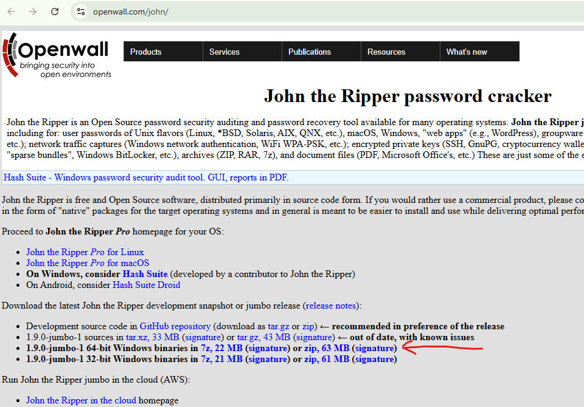
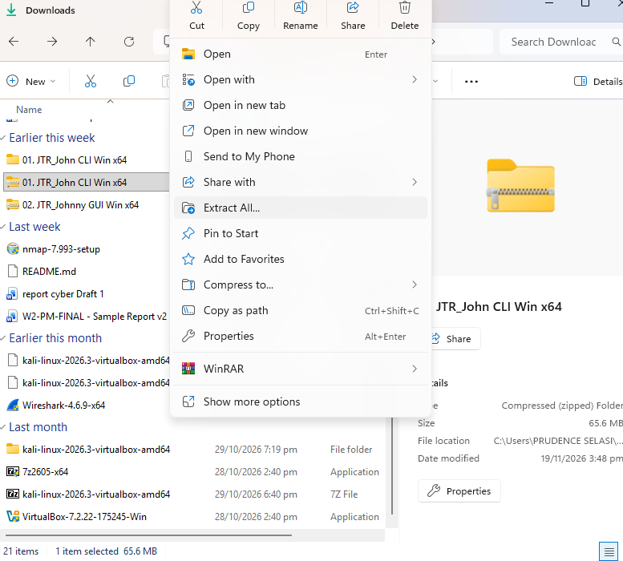

# -PASSWORD-CRACKING-JOHN-THE-RIPPER-AND-NETWORKWALKS-TOOLS-
The aim of the exercises was to understand how a password-protected PDF can be tested to see whether its password can be recovered.

## Introduction

For Week 3 of my cybersecurity internship, I worked on **password cracking** using two different methods.

I used:

1. **John the Ripper (JTR)** – with its graphical interface, Johnny.
2. **Networkwalks Tools** – using the Hash Calculator and Password Cracker available online.

Both methods followed a similar process: first, extract the hash from the locked PDF, then use a password-cracking tool to test possible passwords.

> **Important:** These exercises were carried out using the PDF file provided for the training. Only use password-cracking tools on files you own or have clear permission to test.

---

# Method 1: Password Cracking with John the Ripper (JTR)

## 1. What is John the Ripper?

John the Ripper is a password-testing tool used to check how strong passwords are. It works by trying possible passwords against a stored password hash until it finds a match.

For this exercise, I also used **Johnny**, which is the graphical version of John the Ripper. Instead of entering commands for every action, Johnny allows users to work through a simple interface.

## 2. Tools and Resources Used

| Tool               | Purpose                                              |
| ------------------ | ---------------------------------------------------- |
| John the Ripper    | To test the password hash                            |
| Johnny             | To use John the Ripper through a graphical interface |
| PDF Hash Extractor | To extract the hash from the locked PDF              |
| Notepad            | To save the extracted hash in a text file            |
| Training PDF       | The password-protected file used for the exercise    |

## 3. Step-by-Step Walkthrough

### Step 1: Download John the Ripper

I first visited the official John the Ripper website to download the software for Windows.

**Download link:** [John the Ripper – Official Website](https://www.openwall.com/john/)

I downloaded the Windows version and extracted the files so I could access the program.

### Step 2: Download Johnny

Next, I downloaded Johnny, the graphical interface for John the Ripper.

**Download link:** [Johnny – Official Website](https://openwall.info/wiki/john/johnny)

After downloading it, I ran the setup file and completed the installation.

### Step 3: Open Johnny and Connect It to John the Ripper

After installing Johnny, I opened the application.

I then followed these steps:

1. Clicked on **Settings** on the left side of the application.
2. Selected **Browse** beside the John the Ripper executable option.
3. Located the folder where I extracted John the Ripper.
4. Opened the `run` folder.
5. Selected `john.exe`.
6. Confirmed the selection.

This connected Johnny to the main John the Ripper program so that it could carry out the password-testing process.

### Step 4: Get the Locked PDF File

I downloaded the training PDF file provided for the exercise and saved it on my computer.

This was the file whose password I was going to test.

### Step 5: Extract the PDF Hash

Before John the Ripper could test the password, I needed to get the hash from the PDF.

I opened the PDF Hash Extractor website:

[Online HashCrack – PDF Hash Extractor](https://www.onlinehashcrack.com/tools-pdf-hash-extractor.php)

Then I:

1. Clicked on **Browse**.
2. Selected the locked PDF file from my computer.
3. Clicked **Upload**.
4. Waited for the website to process the file.
5. Copied the hash value displayed on the screen.

**A little thing to watch out for:** The extracted hash should begin with `$pdf$`. I made sure to copy the complete value without leaving out any part.

*For privacy, only use a training file or a file you are authorised to submit to an online service. Do not upload private or confidential documents to a third-party website.*

### Step 6: Save the Hash in a Text File

After copying the hash, I opened Notepad.

I pasted the copied hash into the blank document and saved the file.

This text file contained the hash that Johnny would use for the password-testing exercise.

### Step 7: Load the Hash into Johnny

I opened Johnny again and followed these steps:

1. Clicked **Open password file**.
2. Located the `hash1.txt` file I had just saved.
3. Selected the file and clicked **Open**.

The hash was then loaded into Johnny and displayed in the application.

### Step 8: Start the Password Test

After loading the hash, I clicked **Start new attack**.

John the Ripper began testing possible passwords against the hash.

How long it takes can depend on the computer being used and how difficult the password is to guess.

### Step 9: Check the Result

I waited for the password-testing process to finish.

When a matching password was found, Johnny displayed it in the application.

I then used the recovered password to open the locked PDF file and confirm that it worked.

 

**That completed my first password-cracking exercise using John the Ripper and Johnny.**

---

# Method 2: Password Cracking with Networkwalks Tools

## 1. About the Networkwalks Tools

For the second exercise, I used two online tools provided by Networkwalks.

Unlike the first method, this process did not require me to install John the Ripper or Johnny. I carried out the steps directly in my web browser.

The two tools were:

- **Hash Calculator:** Used to extract the hash from the password-protected PDF.
- **Password Cracker:** Used to test the extracted hash and recover the password.

## 2. Tools and Resources Used

| Tool                          | Purpose                                           |
| ----------------------------- | ------------------------------------------------- |
| Networkwalks Hash Calculator  | To extract the hash from the locked PDF           |
| Networkwalks Password Cracker | To test the hash and recover the password         |
| Web browser                   | To access both online tools                       |
| Training PDF                  | The password-protected file used for the exercise |

## 3. Step-by-Step Walkthrough

### Step 1: Download the Locked PDF

I first visited the Networkwalks project task page and downloaded the PDF file provided for the exercise.

[Networkwalks – Password Cracking with Networkwalks Tools](https://networkwalks.com/project-task-lab-password-cracking-with-networkwalks-tools/)

I saved the file on my laptop so I could upload it to the Hash Calculator.

### Step 2: Open the Networkwalks Hash Calculator

Next, I opened the Hash Calculator in my web browser.

[Networkwalks Hash Calculator](https://networkwalks.com/hash-calculator/)

The tool has different sections for working with text, files and hashes.

### Step 3: Upload the Locked PDF

On the Hash Calculator page, I selected the **File** option.

I then:

1. Clicked on the option to choose a file.
2. Located the locked PDF on my laptop.
3. Selected the file and uploaded it.
4. Waited for the tool to process it.

After processing, the tool displayed the extracted PDF hash.

### Step 4: Copy the Hash

I copied the complete hash displayed by the Hash Calculator.

**Important:** The PDF hash starts with `$pdf$`. I made sure to copy the entire value because leaving out even part of it could affect the next step.

### Step 5: Open the Networkwalks Password Cracker

After copying the hash, I opened the second tool in my browser.

[Networkwalks Password Cracker](https://networkwalks.com/password-cracker/)

This tool is designed to test a PDF hash using possible password combinations from a wordlist.

### Step 6: Paste the Hash and Start Cracking

On the Password Cracker page, I:

1. Located the box labelled **PDF HASH ($pdf$...)**.
2. Pasted the complete hash I copied from the Hash Calculator.
3. Checked that the hash was in the box.
4. Clicked **Start Cracking**.

The tool began testing possible passwords against the hash.

### Step 7: Wait for the Process to Finish

I allowed the tool to complete its process.

The time taken depends on the password being tested and the available wordlist.

Once the tool found a match, it displayed a successful password recovery message on the screen.

### Step 8: Open the PDF File

After recovering the password, I opened the locked PDF file on my laptop.

I entered the recovered password when prompted.

The PDF opened successfully, confirming that the password worked.

**That completed my second password-cracking exercise using the Networkwalks tools.**

---

# Comparing the Two Methods

Both methods helped me understand how password cracking works, but the steps and tools were different.

| John the Ripper (JTR)                                          | Networkwalks Tools                          |
| -------------------------------------------------------------- | ------------------------------------------- |
| Required downloading and installing John the Ripper and Johnny | Worked directly in a web browser            |
| Used a PDF Hash Extractor to get the hash                      | Used the Networkwalks Hash Calculator       |
| Saved the hash in a text file                                  | Copied the hash directly from the website   |
| Loaded the hash into Johnny                                    | Pasted the hash into the Password Cracker   |
| Started the attack through Johnny                              | Started the process through the online tool |

I noticed that the 2 methods generated the same hash value and password recovered. 

## What I Learned

This week's practical exercises helped me understand a few important things about password security:

- **A password hash is not the same as an encrypted password.** Hashing turns information into a fixed-format value that can be tested without simply reading the original password from it.
- **Password cracking involves testing possibilities.** A tool can compare possible passwords against a hash until it finds a match.
- **Weak passwords are easier to guess.** Short, common or predictable passwords may be recovered more quickly.
- **The tools may be different, but the idea is similar.** Both exercises involved extracting a hash and testing possible passwords against it.
- **Strong passwords matter.** Using long, unique and difficult-to-guess passwords makes password recovery attempts harder.

## Conclusion

Week 3 gave me practical experience with two different ways of testing the strength of a password-protected PDF.

Using John the Ripper and Johnny helped me understand how a password-cracking tool can be set up and used through a graphical interface. The Networkwalks tools gave me another way to carry out the same exercise directly in a browser.

The main lesson I took away is that password security should not be taken lightly. A password that looks simple or easy to remember may also be easier for someone else to guess.

**Another week of learning, practising and understanding cybersecurity one task at a time!**

---

*Disclaimer: This walkthrough documents authorised training exercises carried out with the sample PDF provided for the Networkwalks internship. It is intended for learning and password-security awareness. Do not attempt to recover passwords from files or accounts without permission.*
